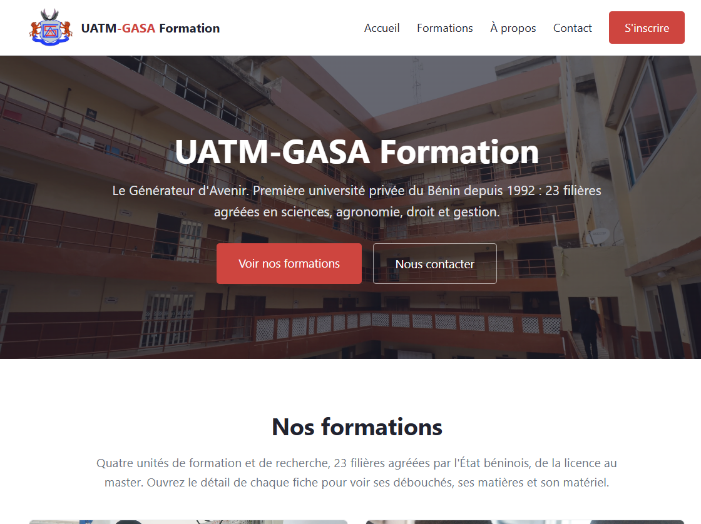
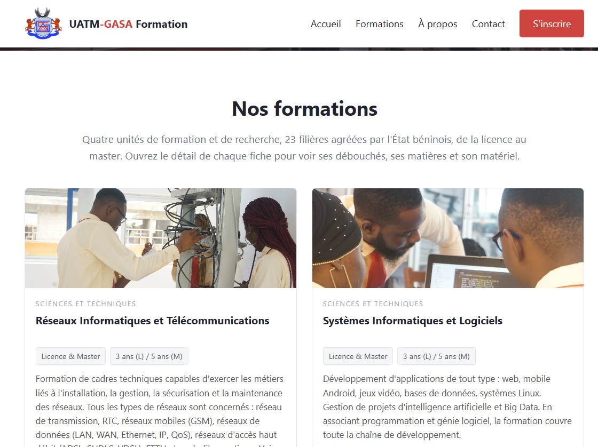
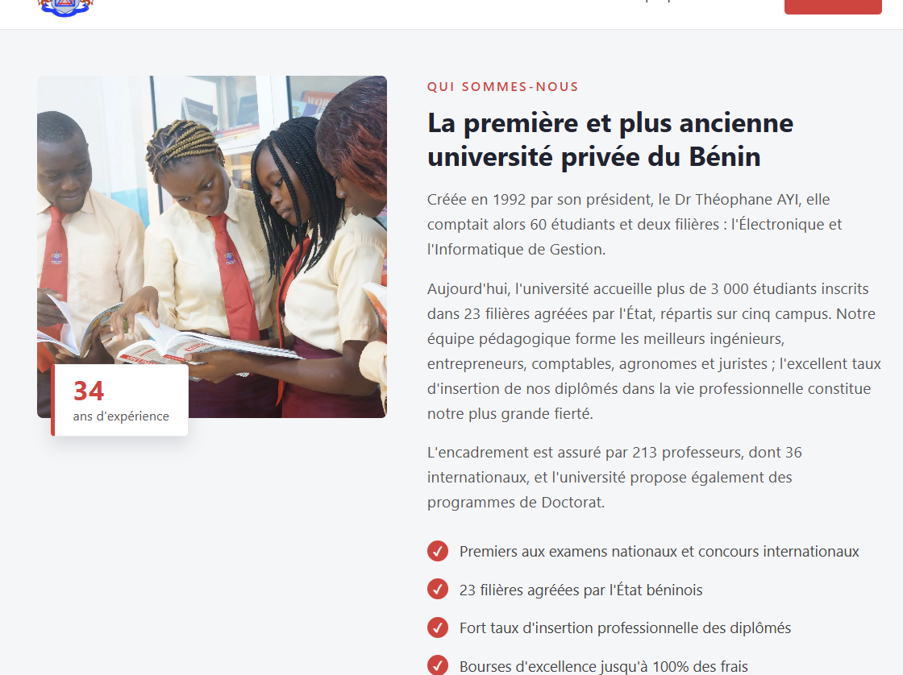

# MISE A NIVEAU SIL 25-26



Projet de mise à niveau du semestre 1 — **Licence 3 SIL**, année universitaire 2026-2027. Il rassemble les travaux pratiques en **C++** (TP1 à TP13), une application **VB.NET** de gestion des notes et un **site vitrine** complet de l'université UATM-GASA Formation (Cotonou, Bénin).

## Captures

| Fiches de formations | À propos |
|---|---|
|  |  |

## Contenu du dépôt

| Dossier | Contenu |
|---|---|
| `TP1/` à `TP13/` | 13 travaux pratiques C++ : saisie et validation, tableaux et algorithmes de tri, Mastermind, calcul de dates, histogramme, classes (`Rectangle`, `Point`, `Compteur`, `Etudiant`), routage IPv4 / IPv6 / CIDR |
| `Activite2_VB/` | Application Windows Forms **VB.NET** (.NET 8) : gestion des notes, classement au mérite avec rang, mentions par matière, édition de bulletins |
| `Activite3_WEB/` | Site vitrine statique en HTML/CSS : 23 filières agréées avec description, durée, matières et débouchés, section à propos (histoire depuis 1992, vision et mission), 8 partenaires, contact réel et formulaire — **100 % hors-ligne**, aucune ressource externe |
| `Executables/` | 18 exécutables Windows précompilés (static), prêts à graver sur le CD de remise |
| `captures/` | Captures d'écran du site utilisées dans ce README |

## Compilation et exécution

### C++ (clang++ / LLVM-MinGW)

```
clang++ -static -Wall -o programme.exe programme.cpp
```

Pour les TP à plusieurs fichiers (ex. TP9) :

```
clang++ -static -Wall -o point.exe point.cpp main.cpp
```

Les 18 binaires correspondant aux TP sont déjà fournis dans `Executables/`.

### VB.NET (.NET 8)

```
cd Activite2_VB
dotnet build
```

Puis exécuter `bin/Debug/net8.0-windows/GestionNotes.exe`.

## Site web

Ouvrir simplement `Activite3_WEB/index.html` dans un navigateur : le site fonctionne hors-ligne (images de l'école incluses).

- **Version en ligne (GitHub Pages)** : https://grandelagbanou28-gif.github.io/mise-a-niveau-sil-2526/
- 23 fiches de formations avec les vrais débouchés, matières et matériel de chaque filière
- Historique de l'établissement (1992 → aujourd'hui), vision, mission et objectifs
- Partenaires officiels (Huawei, UNSTIM, Université de Parakou, UPVD, Grenoble, CAMES…)
- Coordonnées réelles et formulaire de pré-inscription

## Établissement

**UATM-GASA Formation — Le Générateur d'Avenir**
04 BP 1361 Cotonou — 2ème rue à gauche après le CEG Gbégamey, Cadjehoun, Bénin
(+229) 01 65 78 77 21 · info@uatm-gasa.com · www.uatm-gasa.com

## Réalisé par

GRANDEL et AGBANOU — Licence 3 SIL, année universitaire 2026-2027.
